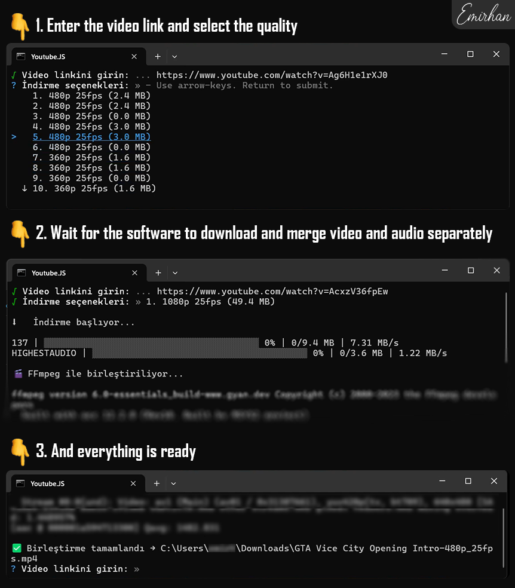

<h1 align="center">Youtube.JS</h1>

<strong>Youtube video download manager</strong>

  

  

  

## 💡 How to run

#### Run the project loop file

> youtube.js.bat
#### or
> node index.js

## ❓ How to use

#### Enter the video link, then select the video quality. It will start downloading to the user's default downloads folder.

